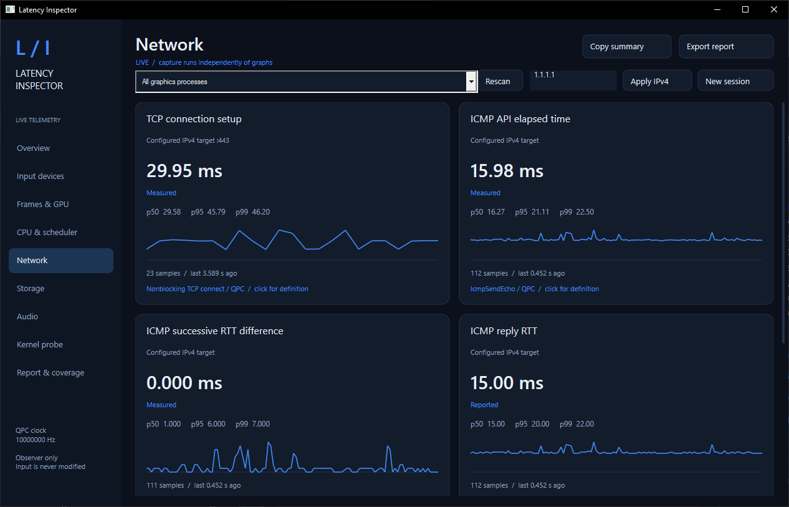

# Latency Inspector

**Windows gaming latency analyzer for input devices, CPU/GPU frames, scheduling, network, storage and audio.**

[Download for Windows x64](https://github.com/TitanCSA/Latency-Inspector/releases/latest) · [Measurement guide](docs/measurements.md) · [Report an issue](https://github.com/TitanCSA/Latency-Inspector/issues)



## Get started

1. Download **Latency-Inspector-1.0.0-Windows-x64.zip** from Releases and extract the whole folder.
2. Run **LatencyInspector.exe**. Accept the administrator prompt for Windows kernel tracing.
3. Select your game in the process list, or keep **All graphics processes**. Changing the selection starts a fresh measurement session.
4. Play normally. Select a category or input device to inspect its graphs. Click a graph card for its exact definition.
5. Use **Export report** to save measurements, percentiles, device identities and collector status as JSON.

Windows 10 version 2004 or later / Windows 11, x64. No runtime installation, account or subscription is required. Keep the bundled `PresentMon.exe` beside the application.

## What it inspects

| Area | Available observations |
| --- | --- |
| Keyboard, mouse and HID controllers | Separate Windows Raw Input device views, message intervals and handler time; includes supported Windows HID views of gamepads. |
| Xbox / XInput / GIP | XInput state-query cost and packet-change intervals per slot; HID views when Windows exposes them; optional passive kernel transport observations. |
| Frames and GPU | Present intervals, CPU busy/wait, GPU busy/wait and queueing timelines, Present API time and software display estimates through Intel PresentMon. Availability depends on the game, graphics driver and presentation mode. |
| CPU and system | ISR/DPC duration, observed thread ready-to-running waits, timer wake lateness, hard faults, CPU and memory usage. |
| Network | Synthetic IPv4 ICMP RTT, successive RTT variation, unanswered probes and TCP port 443 connection setup. Set the target in the top bar. These are separate from the game's network traffic. |
| Storage | Kernel disk read/write response times, plus selected-process I/O volume and attributed disk timings when issuing-thread ownership is available. |
| Audio | WASAPI default, minimum and current shared-engine periods, where exposed by the endpoint. |

Capture runs independently of graph updates. Graphs keep a bounded rolling window of **1,024 samples per metric**, with p50, p95, p99 and session counts. **Report & coverage** explains unavailable sources and trace losses.

### Understand the numbers

**Measured** means an elapsed interval between software timestamps. **Reported** means a value exposed by Windows. **Estimated** means a reconstructed timeline. A missing measurement stays unavailable; it is not displayed as zero latency.

Software alone cannot measure every physical delay. Input message cadence is not switch-to-game latency; an outstanding read includes waiting for input; PresentMon display estimates are not optical pixel measurements; audio periods are not physical sound latency. External hardware or application instrumentation is needed for those stages. See the [measurement guide](docs/measurements.md).

### Optional kernel probe

The passive KMDF filter records input request submission/completion timestamps, lengths and status codes. It never records report contents, changes inputs, blocks devices or creates virtual controllers. Association is per device; Windows class-wide filter lists are not modified.

**The initial kernel probe is awaiting Microsoft signing.** This release works with the Windows/software collectors now. The unsigned probe is not distributed or installed by this release. The **Kernel probe** page explains availability; the signed driver package will be added after signing and validation.

With a future signed package, use **Install / associate probe**, then restart Windows. New device associations also require a restart. **Remove probe** removes only this filter's associations and preserves other drivers. The console equivalent is `LatencyProbeSetup.exe /install`, `/uninstall` or `/status`; exit code `3010` means restart required. Setup retains the staged driver package during removal so active stacks remain safe until restart.

## Reproducible capture

```powershell
.\LatencyInspector.exe --capture 30 --output .\session.json
```

This runs a bounded capture without the dashboard. Reports contain device paths that can include serial numbers. Review them before posting publicly. No keyboard text, mouse positions or gamepad button/report contents are saved. Synthetic network probes go only to the IPv4 target configured for the session (default `1.1.1.1`); measurements are not uploaded.

## Project

This repository contains downloads, documentation and issue tracking. Application, installer and driver source code remain private. There is **no two-hour demo limit** in Latency Inspector.

Frame analysis uses the bundled, unmodified [Intel PresentMon 2.6.0](https://github.com/GameTechDev/PresentMon/tree/v2.6.0), under its MIT license. PresentMon remains a separate process. See [third-party notices](THIRD-PARTY-NOTICES.md) and [license](LICENSE.txt).
